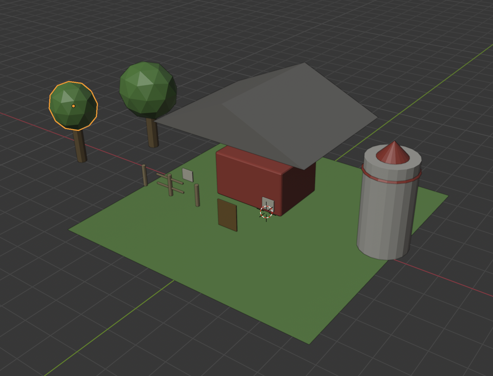
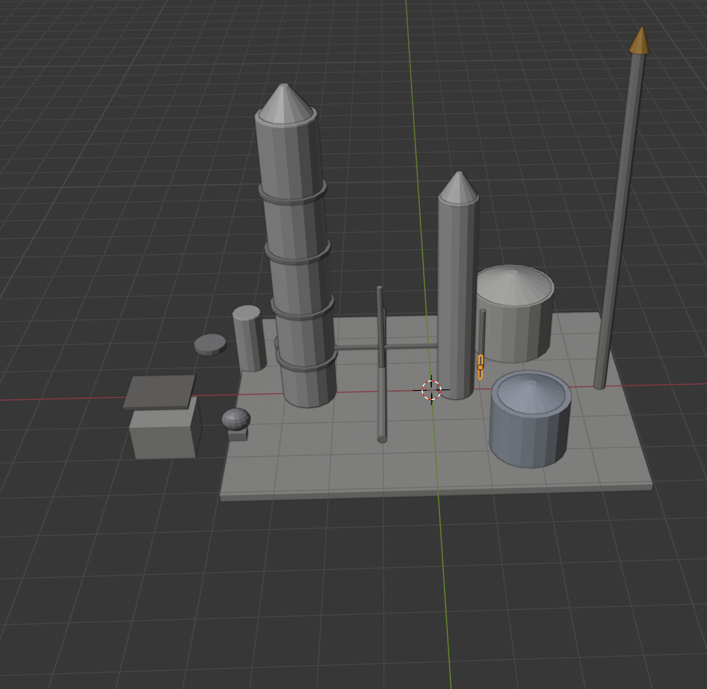

# CAVEMAN

CAVEMAN is a Blender 4.5 extension for quickly building editable mesh primitives and models with Claude. It requires a Claude API key. Describe a model or attach a reference image, and CAVEMAN can create polygon-based shape guides, relief meshes, sculpt passes, paintable textures, Boolean joins and cuts, modifiers, and optional rigs.

## Install

1. In Blender, open **Edit → Preferences → Get Extensions**.
2. Open the menu in the upper right and choose **Install from Disk**.
3. Select `caveman-0.18.0.zip`, then enable CAVEMAN.
4. In **Edit → Preferences → Add-ons → CAVEMAN**, enter your Claude API key and model ID. Blender online access must be enabled.

## Build a model

In the 3D Viewport, open the **CAVEMAN** sidebar tab. Choose a template, enter a prompt, optionally attach a reference image, and click **Generate Model + Timelapse**.

Enable **Generate Image** to ask Claude for a structured shape map made of polygon vertices, region roles, and depth values. Blender rasterizes that map locally into a transparent grayscale PNG and sends it back to Claude as the primary shape reference. The **Image Generation Prompt** field controls the map's composition and depth style. No separate image provider or API key is used. Generated guides are saved under the extension's `generated` data folder and can be opened from the panel.

Claude can describe meshes as vertices and faces, split image silhouettes into connected regions, and connect continuous forms with shared topology or exact Boolean unions. Shape relief and sculpt strokes push and pull details. Plans may also include texture painting, Boolean cuts for openings and bezels, bevel and molding modifiers, and optional armatures with generated weights.

**Screenshot Refinement** is enabled by default. CAVEMAN captures the built scene and sends it with the prompt and optional reference images to Claude for visual edit phases. Disable it to skip the review screenshot and follow-up Claude request. The attached reference image still informs the initial build.

Choose **Speed Model** for a staged build. Use **Visual Edit Phases** to set the number of revisions, and **Play Timelapse** to replay the build. The **Capture Scene Screenshot** button saves a local viewport image without sending it to Claude.

## API and implementation

The add-on uses the Claude Messages API and Blender's `bpy` API. It accepts bounded JSON scene plans and does not execute model-generated Python code. See [INTENTS.md](INTENTS.md) for the schema, limits, Boolean operations, shape guide format, and Blender 4.5 API references.

## Diagnostics

The **CAVEMAN Model Builder** panel includes **View Recent Log** and **Open Full Log**. The log rotates at 2 MB and keeps three backups. It records operation stages, model ID, HTTP status and elapsed time, image metadata, validation results, mesh summaries, and errors. It does not record API keys, prompt text, or image contents. The full log is stored in Blender's extension user data under `logs/caveman.log`.

## Farm example

This low-poly farm scene shows how a prompt can be assembled from separate mesh forms: a red barn with a broad roof, a silo with a conical cap and trim, faceted trees, fence posts and rails, and a green ground plane. The parts stay independently editable, so you can adjust proportions, materials, and placement after generation.

## Refinery Factory example

This industrial scene is built from repeated and varied primitive forms: segmented processing towers, storage tanks, tall exhaust stacks, connecting pipes, small utility structures, and a shared platform. The modular meshes make it quick to block out a factory layout, then refine each vessel and connection independently.

## License

MIT. See [LICENSE](LICENSE).
